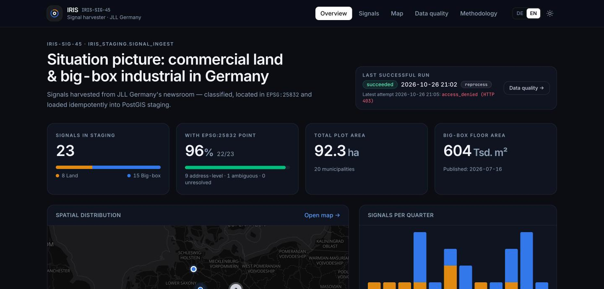
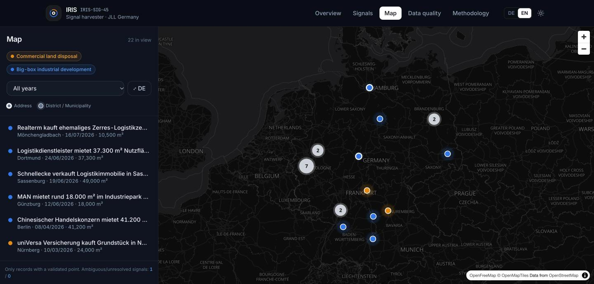
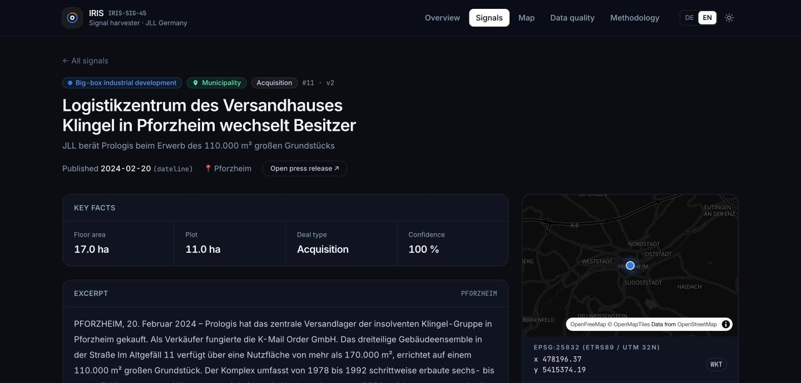
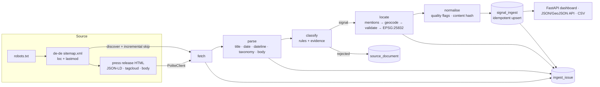
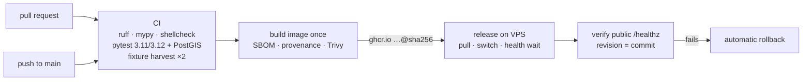

# IRIS-SIG-45 · JLL Germany Research & Transactions Newsroom Harvester

Harvests **commercial land disposals** and **big-box industrial / logistics development** signals from
JLL Germany's public newsroom, classifies and geolocates them, and loads them **idempotently** into
`iris_staging.signal_ingest` (PostgreSQL 16 / PostGIS 3.4, points in **EPSG:25832**). A German-language
dashboard (Tailwind CSS, MapLibre) makes the staged data, every classification decision and every data-quality
issue inspectable.

| | |
|---|---|
| **Live demo** | <https://201-79-3-160.sslip.io> (HTTPS) or <http://201.79.3.160> (plain HTTP by IP) — Lagebild · Signale · Karte · Datenqualität · Methodik |
| **Pattern** | B (HTML) — sitemap discovery + HTML/JSON-LD extraction |
| **Target** | `iris_staging.signal_ingest` (+ run ledger, crawl ledger, issues, geocode cache) |
| **Stack** | Python 3.12 · httpx · BeautifulSoup/lxml · pyproj · psycopg 3 · FastAPI · Jinja2 · Tailwind v4 · MapLibre GL |
| **Tests** | 118 tests (unit + PostGIS 16/3.4 integration + web), 88 % coverage · ruff + mypy --strict clean |



### Results of the live run (26 Oct 2026)

| | |
|---|---|
| Documents discovered → fetched | **701 → 701** (678 newsroom releases + 23 research pages), 0 fetch errors, 17.7 min at 1 req / 1.5 s |
| Staged signals | **23** — 8 commercial land disposals, 15 big-box industrial (publication dates 2022-11 → 2026-07) |
| Located (EPSG:25832) | **22 / 23** validated points — 9 address/street, 3 district, 10 municipality; 1 portfolio deal *ambiguous* (no guessed point) |
| Rejected with reason | 678 — market research 418, personnel 60, office/retail/residential/other domains 130, no single deal 36, below threshold 34 |
| Re-run behaviour | incremental live re-run: **701 / 701 skipped in 2.6 s** (only robots.txt + sitemap requested); full re-processing: 0 inserts, 0 duplicates |
| Validation | **14 / 14** checks pass |
| Source data-quality findings | 18 releases whose JSON-LD date disagrees with their own dateline (dateline wins, flagged), 3 with malformed JSON-LD |

| Map | Signal detail (classification evidence, location trail, lineage) |
|---|---|
|  |  |

---

## 1. Quick start

```bash
cp .env.example .env                      # set POSTGRES_PASSWORD (optionally SITE_ADDRESS, IRIS_NOMINATIM_EMAIL)
docker compose up -d --build              # PostGIS + dashboard + scheduled harvester + TLS proxy
docker compose run --rm harvester harvest # one live, incremental harvest now
open http://localhost                     # dashboard
```

Demonstrable **without network access to jll.com** (fixtures = trimmed real press releases + synthetic edge cases):

```bash
docker compose run --rm harvester harvest --fixtures tests/fixtures/html
```

Everything else:

| Task | Command |
|---|---|
| Full test suite incl. PostGIS (disposable DB) | `docker compose --profile test run --rm tests` |
| Validation queries | `docker compose run --rm harvester validate` (or `psql -f src/jll_harvester/db/validation.sql`) |
| Error / quality report | `docker compose run --rm harvester report --out samples/quality_report.md` |
| Sample exports (GeoJSON, CSV, JSONL) | `docker compose run --rm harvester export --out-dir samples` |
| Verify source access without harvesting | `docker compose run --rm harvester check-source` |
| Re-process everything (ignore `lastmod`) | `docker compose run --rm harvester harvest --full` |
| Re-apply improved rules **without re-fetching** | `docker compose run --rm harvester reprocess` (replays the gzip snapshots in `var/raw/`) |
| Local dev | `make install && make test` · CSS: `npm run build:css` · UI: `jll-harvester serve --reload` |

The CLI (`jll-harvester --help`): `migrate`, `check-source`, `harvest`, `reprocess`, `schedule`, `validate`, `report`, `export`, `serve`.

---

## 2. Data source — verified, not assumed

Checked on every run and stored in `ingest_run.source_check`:

| Finding | Evidence | Consequence |
|---|---|---|
| The brief's endpoint is **obsolete** | `jll.de/de/trends-and-insights/research` → **301** → `jll.com/de-de/insights/market-dynamics` | Redirect chain recorded per run |
| The listing is **client-rendered** and paginates with query strings | teaser grid not in server HTML; "load more" uses `?…` | Listing not usable as a source |
| **robots.txt forbids query strings** | `Disallow: /*?` (evaluated with an RFC 9309 matcher — `urllib.robotparser` silently ignores wildcards) | Listing pagination would violate the site's policy |
| **Justified alternative:** robots-advertised sitemap | `https://www.jll.com/de-de/sitemap.xml` lists every `/de-de/newsroom/…` press release and `/de-de/insights/market-dynamics/…` report with `<lastmod>` | Complete, pagination-free enumeration **and** incremental retrieval |
| Pages carry structured metadata | schema.org `NewsArticle` JSON-LD (`headline`, `datePublished`), JLL taxonomy `<meta name="ch.tagcloud">`, dateline `MÖNCHENGLADBACH, 16. Juli 2026 –` | Publication dates verified against two sources |
| **Datacenter IPs are denied by JLL's CDN** | from the VPS every URL incl. `robots.txt` → `403 AkamaiGHost` | Recorded as `access_denied`; **not bypassed** (no proxies, no UA spoofing, no header tricks) |

**How the demo data was obtained.** Because Akamai blocks the hosting provider's IP range, the scheduled job on
the VPS records an `access_denied` run (visible under *Datenqualität*). The staged data in the demo was harvested by
the *same* code, with the same identifying User-Agent and politeness settings, from a workstation network where the
site is publicly served, writing to the VPS database through an SSH tunnel (the DB is never exposed publicly).
In production IRIS would run the harvester from an egress JLL permits, or ask JLL for an allow-listing.

Politeness: identifying User-Agent, ≥ 1.5 s between requests (or `Crawl-delay` if larger), robots.txt honoured
per URL, retries only for 408/425/429/5xx/network errors with exponential backoff + jitter + `Retry-After`,
never for other 4xx.

---

## 3. Architecture



| Module | Responsibility |
|---|---|
| `robots.py` | RFC 9309 robots.txt evaluation (wildcards, `$`, longest-match, UA groups) |
| `http.py` | `PoliteClient`: throttling, retries/backoff, error classification (`not_found`, `access_denied`, `timeout`, `empty_response`, …) |
| `discovery.py` | Sitemap / sitemap-index parsing (XXE-safe), section filter, de-duplication, newest-first |
| `parsing.py` | HTML → `Article`; JSON-LD, dateline, taxonomy, boilerplate removal, date cross-check |
| `classify.py` | Signal rules, German number/area parsing, deal type, confidence + evidence |
| `gazetteer.py` | Bundled GeoNames gazetteer (80 k German places/districts, CC BY 4.0) and context-aware place extraction |
| `geocode.py` | Location choice, Nominatim + offline geocoders, coordinate validation, EPSG:25832 projection |
| `normalize.py` | Staging record, quality flags, idempotency hash, geographic (Germany) filter |
| `pipeline.py` | Orchestration, per-document transactions, run report, live/fixture sources |
| `db/` | Migration, repository (upserts, ledgers, advisory lock, geocode cache), read queries, `validation.sql` |
| `web/` | Dashboard (German/English), API, exports |

---

## 4. Signal definitions & domain filtering

Rules are explicit German-language patterns over the headline, lead and JLL taxonomy. They are not a black box:
every record stores the rules that fired, the scores for both types and the evidence snippets
(`classification_evidence`, shown on each signal's page).

**`commercial_land_disposal`** — a *plot / site / brownfield* (Grundstück, Areal, Gelände, Brownfield,
Baufeld …) changes hands (erwirbt, kauft, verkauft, veräußert …).
Penalised: the traded object is a standing building ("Bürogebäude", "Fachmarktzentrum"), the plot merely carries a
building ("Auf dem … Grundstück steht ein 2016 errichtetes Gebäude"), residential land, lettings.

**`big_box_industrial_development`** — industrial/logistics context (JLL taxonomy
`industrial-and-logistics` / `data-center-property`, or strict terms such as *Logistikzentrum, Hallenfläche,
Produktion, Light Industrial, Rechenzentrum, Möbelfabrik*) **and** either a development cue (*Projektentwicklung,
Neubau, Baustart, spekulativ, Revitalisierung, Baugenehmigung …*) **or** a big-box deal size ≥ 10 000 m²
(`IRIS_BIG_BOX_MIN_SQM`). For lettings the *let* area counts, not the building
("bezieht 2.050 m² im 35.000 m² großen Objekt" is not big-box).

**Rejected with a stored reason** (`source_document.decision_reason`): `market_research` (aggregate market reports),
`personnel_news`, `not_a_single_deal` (cooperations, commentary), `out_of_domain:<property type>`,
`below_confidence_threshold`, `outside_germany`.

**Geography:** de-de newsroom + a German municipality from the gazetteer (or JLL's `location/…/germany` tag);
international releases are dropped as `outside_germany`.

---

## 5. Mapping to `iris_staging.signal_ingest`

DDL: [`src/jll_harvester/db/migrations/001_init.sql`](src/jll_harvester/db/migrations/001_init.sql).

| Column | Source / rule |
|---|---|
| `source_system`, `source_record_id` | `jll_de_newsroom`, lower-cased URL path below the locale (`newsroom/<slug>`) — **natural key, UNIQUE** |
| `source_url`, `canonical_url` | fetched URL, `<link rel=canonical>` |
| `signal_type` | classifier (CHECK-constrained to the two in-scope types) |
| `title`, `summary` | JSON-LD `headline` → `og:title` → `<h1>`; meta description |
| `published_at`, `published_at_source` | JSON-LD `datePublished` (`json-ld`) when it agrees with the release's dateline (± 2 days); otherwise the dateline date (`dateline`) with a `date_mismatch_…` flag — on jll.com the JSON-LD date is often the CMS republication date (exactly 91 / 365 days off) |
| `source_lastmod` | sitemap `<lastmod>` (drives incremental runs) |
| `deal_type` | acquisition · disposal · letting · development (headline first, then lead) |
| `area_sqm`, `plot_area_sqm` | deal / building area and plot area in m² (German number formats, `ha` → m²) |
| `property_types`, `source_tags` | JLL taxonomy |
| `classification_confidence`, `classification_evidence` | 0–1 score; rules, scores, snippets, areas |
| `municipality`, `district`, `street`, `postal_code`, `location_text` | chosen location |
| `geocode_status` | `resolved` · `ambiguous` · `unresolved` · `invalid` |
| `geocode_precision`, `geocode_provider(_ref)`, `geocode_confidence`, `geocode_notes`, `location_candidates` | how the point was obtained, every candidate considered and why others were rejected |
| `geom` | `geometry(Point, 25832)` — present **iff** `resolved` (CHECK), valid and inside Germany (CHECK) |
| `quality_flags` | e.g. `published_at_from_dateline`, `location_coarse_municipality`, `location_ambiguous`, `low_classification_confidence` |
| `content_hash`, `record_version` | SHA-256 over business fields; version increments only on real change |
| `raw_sha256`, `payload` | hash of the fetched HTML (gzip snapshot kept under `var/raw/`), full normalised record + excerpt |
| `first/last_ingest_run_id`, `first/last_seen_at`, `updated_at` | lineage |
| `retracted_at`, `retraction_reason` | set when a later run no longer classifies the page as a signal (never silently deleted) |

Supporting tables: `ingest_run` (one row per run: mode, config, source verification, statistics),
`source_document` (every discovered URL and its decision — the incremental-crawl ledger), `ingest_issue`
(errors / warnings / info per run), `geocode_cache`, view `v_signal_map` (WGS84 for web maps).

---

## 6. Locations → EPSG:25832

1. **Mentions** with provenance and weight: street address (`am Regioparkring 4`, `Adresse Grundfeld 1`),
   postcode, hyphenated district (`Bonn-Auerberg`), district phrase (`im Bonner Stadtteil Auerberg`), facility name
   (`Logistikpark Dombühl`, `Segro Park Dortmund`, `Projekt Hoppegarten`), preposition (`in Mönchengladbach`, `im unterfränkischen
   Elfershausen`), demonym (`Kölner …`), dateline. Words that are also places (*Lage, Halle, Mitte, Essen …*) are
   only accepted in explicit context; "im **benachbarten** Eschweiler" is down-weighted, and "**bei / nahe** Berlin"
   counts as a *proximity* mention (the site is near, not in, the town — flagged `location_near_reference_town` if
   nothing more precise exists).
2. **Choice:** mentions are aggregated per municipality. A street attaches to the nearest preceding place in the
   same paragraph. If several towns > 30 km apart are equally plausible (portfolios, "Frankfurt und Mannheim") the
   record is **`ambiguous`** and keeps its candidates instead of a guessed point. A region-only mention
   ("in Oberbayern") is **`unresolved`**. The dateline (often the issuing JLL office) is used last and flagged.
3. **Geocoding**, most precise first: Nominatim (OSM; ≤ 1 req/s, identifying UA, DB-cached) for address →
   district → municipality, then the bundled GeoNames gazetteer (district/municipality centroids) as offline
   fallback. Every downgrade is noted.
4. **Validation before anything is stored:** finite, inside the German bounding box, provider country = DE,
   ≤ 30 km from the expected municipality's centroid, inside the EPSG:25832 envelope. A failing answer is
   discarded with its reason; if no answer survives, the record is **`invalid`** (no point). The database enforces
   the same envelope and the point ⇔ `resolved` rule with CHECK constraints, so an invalid coordinate cannot be
   accepted silently even by a buggy client.
5. **Projection:** pyproj `EPSG:4326 → EPSG:25832` (always_xy); `projection_roundtrip` re-checks it in PostGIS.

---

## 7. Robustness

| Concern | Handling |
|---|---|
| **Idempotency / duplicates** | UNIQUE natural key; `INSERT … ON CONFLICT DO NOTHING` + row lock; hash-based no-op for unchanged content; canonical-URL duplicate check; tested by running the same harvest three times |
| **Incremental retrieval** | unchanged sitemap `<lastmod>` + previous decision ⇒ skipped (`skipped_unchanged`); `--full` re-processes; failed documents are always retried |
| **Concurrency** | Postgres advisory lock — a second harvest exits with "skipped" instead of racing |
| **Network failures** | classified retries with backoff, `Retry-After`; per-document isolation — a failure becomes an `ingest_issue` and the run continues (`partial`) |
| **Malformed data** | malformed sitemap XML (XXE-safe parser), broken JSON-LD (dateline fallback + flag), missing body/title (`parse_error`), impossible dates |
| **Empty responses** | empty body ⇒ `empty_response`; empty sitemap ⇒ warning issue |
| **Access restrictions** | robots.txt per URL; 401/403 ⇒ `access_denied`, never circumvented |
| **Reclassification** | records that stop qualifying are retracted with a reason, not deleted; `reprocess` re-applies rule changes from stored snapshots, so improving the rules never costs another crawl |
| **Secrets** | none in code; `IRIS_DATABASE_URL` from env / `.env` (git- and docker-ignored); DB port bound to localhost |

---

## 8. Validation & quality report

[`src/jll_harvester/db/validation.sql`](src/jll_harvester/db/validation.sql) holds 14 annotated checks (duplicate
keys, duplicate URLs, SRID, geometry validity and German extent, point/status consistency, projection round-trip,
mandatory fields, signal-type domain, future dates, missing dates, orphan records …). They run from `psql`, from
`jll-harvester validate` (exit code 1 on an error-level failure), on the *Datenqualität* page and in
`/api/checks`.

`jll-harvester report` renders the concise error/quality report: [`samples/quality_report.md`](samples/quality_report.md).

---

## 9. Sample output

[`samples/`](samples/) contains public-source output of the live run:
`signals.geojson` (WGS84 + `x_25832`/`y_25832` properties), `signals.csv`, `signals.jsonl`, `quality_report.md`.

---

## 10. Tests

```bash
make test                                            # unit tests, no database (≈1 s)
docker compose --profile test run --rm tests         # + PostGIS 16/3.4 integration + web, with coverage
```

* **Fixtures**: 13 real JLL press releases trimmed to the parsed parts (`scripts/make_fixture.py`) and 5 synthetic
  edge cases (malformed JSON-LD, missing body, empty file, residential land, region-only location), plus a fixture
  sitemap containing a missing page, a query-string URL and an out-of-section URL.
* **Coverage of the brief**: robots semantics; retries/backoff/`Retry-After`/no-retry-on-404/access-denied; sitemap
  parsing incl. XXE; parsing & date verification; classification (in-scope and every rejection reason); German
  numbers and area typing; place extraction, ambiguity, region-only, invalid coordinates, mocked Nominatim incl.
  outage, far-away and foreign answers; **re-run/duplicate behaviour** (three runs, content change → version 2,
  retraction); DB constraints rejecting bad geometry; validation queries; all dashboard pages, API, exports,
  basic auth.

---

## 11. CI/CD

[](https://github.com/shahidkarimi/iris_osint/actions/workflows/ci.yml)
[](https://github.com/shahidkarimi/iris_osint/actions/workflows/deploy.yml)



* **[`ci.yml`](.github/workflows/ci.yml)** — every PR: lint and strict typing, the full test suite on Python 3.11 and
  3.12 against a real PostGIS 16/3.4 service, ≥ 85 % coverage, an end-to-end offline harvest that is run twice and
  must not change the row count, `jll-harvester validate`, and a Docker build.
* **[`deploy.yml`](.github/workflows/deploy.yml)** — every push to `main` re-runs the same CI, builds the image
  **once**, pushes it to GHCR (`sha-<commit>` + `latest`) with SBOM and signed build provenance, scans it with Trivy
  (results in *Security → Code scanning*), and releases it to the `production` environment **by digest**.
  [`deploy/deploy.sh`](deploy/deploy.sh) on the server pulls the image, switches the services, waits for their
  health checks and confirms that `/healthz` reports the deployed commit; the workflow then checks the public URL
  and every dashboard page. Any failure rolls back to the previous image automatically.
* **Rollback / redeploy** — *Actions → Deploy → Run workflow* with `image` set to an earlier tag
  (e.g. `ghcr.io/shahidkarimi/iris_osint:sha-1a2b3c4`), or on the server `deploy/deploy.sh rollback`.
* **Security** — actions pinned to commit SHAs, least-privilege job permissions, a dedicated `deploy` user whose key is
  `restrict`ed (no TTY or forwarding) and lives only in the `production` environment (deployable from `main`
  only), pinned SSH host keys, the registry token is the job's short-lived `GITHUB_TOKEN`, and one multiplexed SSH
  connection per deploy (the server rate-limits SSH). Dependabot proposes weekly grouped updates.
* **Configuration** — environment `production`: secrets `DEPLOY_SSH_KEY`, `DEPLOY_KNOWN_HOSTS`; variables
  `DEPLOY_HOST`, `DEPLOY_USER`, `DEPLOY_PATH`, `PUBLIC_URL`. Server secrets stay in the server's `.env`, which CI
  never reads or writes except for the released image reference (`IRIS_IMAGE`, `IRIS_IMAGE_PREVIOUS`).

---

## 12. Configuration

All settings are environment variables (prefix `IRIS_`), see [`.env.example`](.env.example) and
[`config.py`](src/jll_harvester/config.py). Most relevant:

| Variable | Default | Meaning |
|---|---|---|
| `IRIS_DATABASE_URL` | — (required) | PostgreSQL DSN |
| `IRIS_GEOCODER` | `nominatim` | `nominatim` (+offline fallback) · `offline` · `none` |
| `IRIS_NOMINATIM_EMAIL` | — | contact address for Nominatim's usage policy |
| `IRIS_REQUEST_DELAY_SECONDS` | `1.5` | minimum spacing between requests |
| `IRIS_BIG_BOX_MIN_SQM` | `10000` | big-box size threshold |
| `IRIS_MIN_CLASSIFICATION_CONFIDENCE` | `0.5` | acceptance threshold |
| `IRIS_SECTION_PREFIXES` | `/de-de/newsroom/,/de-de/insights/market-dynamics/` | sitemap sections in scope |
| `IRIS_MAX_DOCUMENTS_PER_RUN` | `0` | cap per run (0 = unlimited) |
| `HARVEST_INTERVAL_SECONDS` | `21600` | scheduler interval |
| `SITE_ADDRESS` | `:80` | hostname for automatic HTTPS via Caddy |
| `PLAIN_HTTP_HOST` | `127.0.0.1` | extra host (e.g. the server's IP) served over plain HTTP, since an IP gets no certificate |
| `IRIS_WEB_BASIC_AUTH_USER/PASSWORD` | — | optional dashboard protection |
| `IRIS_LOG_FORMAT` | `text` | `json` for structured logs |
| `IRIS_IMAGE` | `iris-sig45:latest` | image the stack runs; set by the deploy pipeline to a `ghcr.io/…@sha256` digest |

---

## 13. Assumptions

* "Research & Transactions Newsroom" = JLL DE press releases (`/de-de/newsroom/`) plus research pages
  (`/de-de/insights/market-dynamics/`); research pages are assessed but aggregate market reports are out of scope.
* *Commercial* land excludes purely residential plots; mixed-use and corporate-HQ plots are commercial.
* *Big-box*: ≥ 10 000 m² deal/floor area **or** an industrial development scheme; big-box lettings and acquisitions of
  industrial assets count as signals (deal type recorded), small industrial lettings do not.
* One signal per press release (primary type, the other recorded in `also_matches`); a land trade named in the
  headline wins over a big-box match.
* A coordinate is only stored for a single, unambiguous site; municipality centroids are acceptable but flagged
  (`location_coarse_municipality`).
* Staging is append/update with retraction — downstream consumers decide on deletion.

## 14. Known limitations

* **Source access** depends on the egress network (Akamai denies datacenter IPs — see §2).
* Rule-based classification is tuned on the JLL DE corpus (≈ 700 pages) — precise but brittle to style changes;
  new phrasing lowers confidence rather than producing false positives. A labelled set + model would be the next step.
* Address precision needs Nominatim; offline mode stops at district/municipality centroids.
* JLL's own taxonomy is occasionally wrong (a factory deal tagged "office"); strong industrial headlines override it.
* Multi-site portfolios produce one `ambiguous` record, not one point per site.
* Only German-language press releases are parsed (`de-de`); `en-de` duplicates are out of scope.

---

## 15. Repository layout

```
src/jll_harvester/        package (CLI, pipeline, db, web)
  data/gazetteer_de.tsv.gz   GeoNames extract (CC BY 4.0), built by scripts/build_gazetteer.py
  db/migrations/001_init.sql  schema · db/validation.sql  checks
  web/templates, web/static   dashboard (Tailwind source in static/src, built CSS in static/dist)
tests/                    unit, integration and web tests + fixtures
scripts/                  build_gazetteer.py, make_fixture.py
samples/                  sample output + quality report
deploy/                   Caddyfile (TLS reverse proxy), deploy.sh (server-side release + rollback)
.github/                  CI, deploy pipeline, Dependabot
docker-compose.yml, Dockerfile, .env.example, Makefile
```

Data attribution: press releases © JLL (public pages, used for research); places © GeoNames (CC BY 4.0);
geocoding & basemap © OpenStreetMap contributors, OpenFreeMap / OpenMapTiles.
